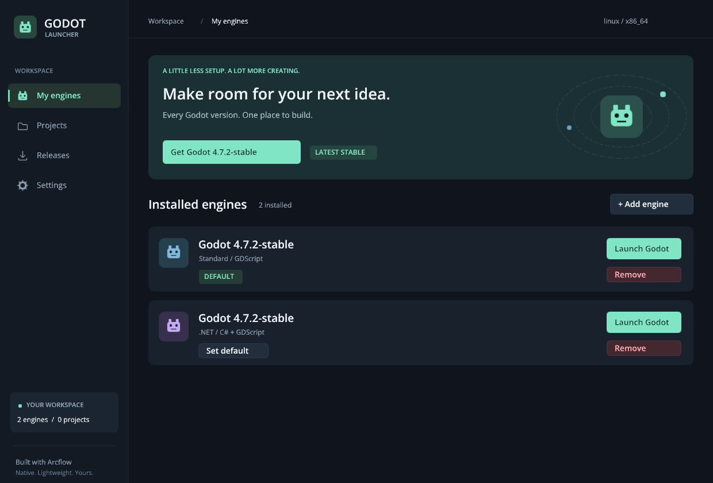

# Godot Launcher

A native Godot engine manager built with your **Arcflow / AF Framework**. The UI uses
AF scene geometry, vector text, hover feedback, and SDL3 input. Linux and Windows use
the framework's Vulkan renderer; macOS renders the same AF scene with CoreGraphics.

[Download development builds](https://github.com/stmSi/godot-launcher/releases/tag/nightly)
· [All releases](https://github.com/stmSi/godot-launcher/releases)
· [Build status](https://github.com/stmSi/godot-launcher/actions/workflows/build.yml)



- Install recent official Godot 4 Standard and .NET builds for the host OS and architecture.
- Browse stable and preview channels, search versions, and open release notes by clicking a version.
- Download in the background with progress, cancellation, SHA-256 verification, and SHA-512 fallback.
- Update engines side by side, choose a default, and launch Godot's project manager.
- Import or drop `project.godot`, select an engine per project, and open the editor.
- Keep the cached release browser available offline. Engine removal preserves project files.
- Use a resizable desktop UI with keyboard focus, search, and a removal confirmation dialog.

The launcher manages engine updates. Self-updating the launcher and installing export templates
are outside this version. .NET engine builds require a compatible .NET SDK installed separately.
Only one transfer runs at a time; interrupted downloads restart on the next attempt.

## Build in this workspace

The default configuration uses `../Arcflow/framework` and `../Arcflow/third_party` without
modifying either checkout. Requires CMake 3.25+, Ninja, a C17 compiler, libcurl, libarchive,
OpenSSL, and json-c. The framework also needs FreeType, HarfBuzz, and SDL3. Linux/Windows
builds need Vulkan headers, volk, `glslc`, and `spirv-val`; the local Arcflow checkout
already provides the framework's source dependencies and shader tools.

```sh
cd /home/stm/my-projects/godot-launcher
cmake --preset debug
cmake --build --preset debug --parallel 6
ctest --preset debug
./build/debug/godot-launcher
```

For the verified engines installed during development:

```sh
./build/debug/godot-launcher --data-dir "$PWD/build/live-data"
```

## Build elsewhere

Fetch the pinned AF Framework, SDL3, Vulkan headers, and volk:

```sh
python3 tools/bootstrap.py
cmake --preset release
cmake --build --preset release --parallel 3
ctest --test-dir build/release --output-on-failure
cmake --install build/release --prefix out
```

You can instead point at existing checkouts:

```sh
cmake --preset debug \
  -DARCFLOW_FRAMEWORK_SOURCE_DIR=/path/to/af-framework \
  -DAF_FRAMEWORK_DEPENDENCY_ROOT=/path/to/third_party
```

**Linux (Debian/Ubuntu):** install `build-essential cmake ninja-build pkg-config
libcurl4-openssl-dev libarchive-dev libssl-dev libjson-c-dev libfreetype6-dev
libharfbuzz-dev libx11-dev libxext-dev libxcursor-dev libxfixes-dev libxi-dev
libxrandr-dev libxss-dev libxtst-dev glslc spirv-tools`. Run `out/bin/godot-launcher`.
A Vulkan 1.3 driver and an X11/XWayland session are required by the pinned framework build.

**Windows:** use the MSYS2 UCRT64 toolchain and the packages in
[the build workflow](.github/workflows/build.yml). Build with Ninja/GCC, then run
`python tools/collect-windows-dlls.py out/bin/godot-launcher.exe` to copy runtime DLLs.
Launch `out/bin/godot-launcher.exe`. Filesystem calls preserve UTF-8 project and profile paths.

**macOS:** install `cmake ninja curl libarchive openssl@3 json-c freetype harfbuzz pkgconf`
with Homebrew. Set `CMAKE_PREFIX_PATH` and `PKG_CONFIG_PATH` as shown in the workflow
for Homebrew's keg-only libraries. The install step produces `out/godot-launcher.app`,
bundles its dylibs, and applies an ad-hoc signature. Launch with
`open out/godot-launcher.app`. This backend does not require MoltenVK.

Linux runtime behavior has been tested here. Windows application sources have been
cross-compiled with MinGW; complete Windows and macOS builds/runtime still need native
validation. The GitHub Actions workflow builds and tests all three platforms when run.

## CI/CD and releases

[The GitHub Actions workflow](.github/workflows/build.yml) builds release executables
and runs core tests on Linux x86_64, Windows x86_64, macOS arm64, and macOS x86_64.
It also checks the installed Linux UI, Windows runtime DLLs, and macOS bundle signatures.
Release builds disable Vulkan validation. Pull requests run the checks without publishing.

After all platform jobs pass, a push to `main` publishes or updates the **nightly**
prerelease. Version tags publish stable releases (or prereleases for tags with a suffix):

```sh
# Keep the CMake project version in sync before creating a version tag.
git tag v0.1.0
git push origin v0.1.0
```

The workflow also supports **Actions → Build, test, and release → Run workflow**.
Publishing uses the workflow's `GITHUB_TOKEN`; no personal access token is needed.
Only the publishing job receives `contents: write`.

Downloadable assets are `godot-launcher-linux-x86_64.tar.gz`,
`godot-launcher-windows-x86_64.zip`, `godot-launcher-macos-arm64.zip`,
`godot-launcher-macos-x86_64.zip`, and `SHA256SUMS.txt`. Each archive includes
`BUILD-INFO.json` identifying its source commit. Windows DLLs and macOS dylibs are bundled.
macOS archives preserve bundle symlinks and signatures; the app is ad-hoc signed and
is not notarized. Linux uses the runtime libraries documented above.

## Controls and command line

Use **My engines**, **Projects**, **Releases**, and **Settings** in the sidebar.
`Tab` / `Shift+Tab` move focus; `Enter` activates a button; `Ctrl+F` opens search;
`Esc` dismisses a confirmation or search focus. Mouse wheel and Page Up/Down scroll lists.
Click an imported project's **Engine** button to cycle through installed versions.

```sh
godot-launcher --list
godot-launcher --install 4.7.2-stable
godot-launcher --install 4.7.2-stable --mono
godot-launcher --offline
godot-launcher --data-dir /path/to/separate-library
godot-launcher --offline --page 2 --frames 5 --capture releases.png
```

The default library comes from SDL's per-user preference directory for
`Arcflow/GodotLauncher`. **Settings → Open folder** shows the location. A library contains:

```text
library.json                 Installed engines, default, projects, and project engine pins
releases.json                Last successfully fetched release catalog
engines/<version>-standard/  Managed engine installations
engines/<version>-mono/      Managed .NET installations
downloads/engine.zip.part    Current temporary download
```

HTTPS downloads are checked against the release asset digest, or the release's
`SHA512-SUMS.txt` for older assets. Extraction rejects absolute paths, `..`, links,
special files, and oversized archives. Staging directories are renamed into place only
after verification and extraction succeed. Metadata writes are atomic, and an OS file
lock prevents two launcher instances from modifying the same library.

## Validation

`ctest` covers platform/architecture asset selection, version comparisons, known SHA-256
vectors, checksum rejection, extraction cancellation, installation/reload/removal,
project persistence, path traversal, and archive links.

An optional Linux X11 interaction test uses `xdotool` and ImageMagick. Fetch a catalog
first, then run it with your test display:

```sh
./build/debug/godot-launcher --data-dir build/live-data --list
python3 tests/test_ui.py --catalog build/live-data/releases.json
```

It creates an isolated temporary library, checks launch arguments (including project paths
with spaces), confirmation behavior, filters, search, resize, download cancellation, and
library locking. It uses live HTTPS for the cancellable download and saves a progress
screenshot under `build/`. All temporary project/engine fixtures are removed afterward.

Official release metadata: [Godot builds](https://github.com/godotengine/godot-builds/releases),
[GitHub Releases API](https://docs.github.com/en/rest/releases/releases).
Bundled Open Sans fonts are licensed under [OFL 1.1](assets/fonts/OFL.txt).
Godot icon artwork and the macOS distribution icon retain their upstream
[attribution and licenses](assets/README.md).
